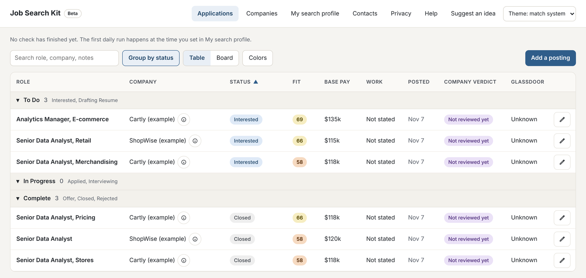

# Job Search Kit

A job-search system you install on your own computer. It watches the job boards you pick, scores every posting against your own criteria, keeps a tracker, and, with the Claude plugin, builds your evidence bank and tailored resumes from it. Everything stays on your computer. Nothing is sent anywhere except the job boards you ask it to read and, when you use the plugin, the Claude app you already pay for.

**Beta.** Free, provided as is, and built for a friend first. You review and confirm everything before you send it; the kit never sends anything for you. Windows installer now, Mac later. MIT licensed.

<picture>
  <source media="(prefers-color-scheme: dark)" srcset="docs/images/tracker-dark.png">
  
</picture>

*The tracker with six example postings from made-up companies.*

## What it does
- **Daily board checks.** A scheduled run reads the careers pages and job feeds you chose, scores each posting from 0 to 100 against your criteria (titles, level, pay, where and how you work, direct reports, travel, industries you won't work in, benefits), reads each posting's required section item by item against your own evidence, labels every posting Strong fit, Possible fit, or Poor fit with the reason in plain words, and never decides for you. Applying and Passed are yours to set.
- **Tracker.** A local page (127.0.0.1 only) with your applications (a sortable table grouped by status, or a board), your companies and the research you or Claude add for each, your search profile, and contacts, in light or dark. Paste any link you find elsewhere and it gets scored like the daily finds. No Notion needed (it's optional).
- **Evidence bank and resumes.** The Claude plugin (`plugin/`) interviews you over four short sessions and builds your North Star, evidence bank, rules, and master resume in your words. For each posting it selects approved bullets into a tailored resume and cover letter, builds the Word files, and runs a pre-send gate that traces every bullet back to your bank. Nothing goes on a page that you didn't say.
- **Daily backups.** After each daily run, your tracker, contacts, evidence bank, and settings are zipped into the data folder's `backups/`, 14 days kept, on your computer only. `app/backup.py restore` puts them back (and backs up first, so a restore can be undone).
- **Updates that never touch your data.** The app checks GitHub releases daily and installs signed updates quietly, 72 hours after each release comes out (the maintainer can pause every update with an `UPDATES_PAUSED` file in this repository); your folder, settings, bank, applications, and tracker are never changed by an update.

## Layout
- `app/` the code: `agent/` (job board agent, fit scoring, built-in tracker, tests), `resume/` (bank index, resume builder, pre-send gate, reviewer prompts), `kit_settings.py` (loads a user's settings), `first_run.py` (chooses and creates the user's folder), `wizard.py` and `wizard_page.html` (setup wizard and tracker page), `schedule.py` (daily runs), `tracker_cli.py` (tracker access for the plugin), `error_report.py` (scrubbed error reports), `updater.py` (auto-update), `platform_support.py` (notifications, LibreOffice lookup)
- `plugin/` the Claude plugin: `start-here`, `application-materials`, `evidence-interview`, `approval-session`, `kit-basics`, and two reviewer agents
- `templates/` the files a new user's Job Search folder starts from, including a neutral `settings/` folder
- `examples/` three synthetic test people with planted traps (see `examples/README.md`); the tests run against them
- `docs/images/` the screenshots in this README (from the `dana-retail-analytics` example, no real data)
- `installer/` the Windows installer build (Inno Setup) and release pipeline inputs
- `SETTINGS.md` every user setting, grouped by setup question. A test fails if the code reads a setting that isn't listed there

## Privacy
Your settings, evidence bank, applications, and tracker are plain files in a folder you choose (the wizard asks, and warns when your Documents folder is synced to OneDrive). The kit connects to no email or other accounts. The only data that leaves your computer: requests to the job boards you chose, a once-a-day check of this project's GitHub releases page for updates (GitHub sees your computer's internet address and nothing else; turn it off in the setup wizard under How it runs), and what you yourself put in front of Claude when you use the plugin. Error reports are opened in your own mail app, hold only a scrubbed run log, and go nowhere until you press Send. Logs are kept about 30 days, and the Privacy page has a Delete your data button (records only, or everything the kit made). There is no telemetry: the kit collects no usage data, analytics, or crash reports on its own. The public repository holds code only; a leak test runs on every commit.

## Code signing policy
Windows installers are built only by this repository's Release workflow on GitHub's machines, from the tagged source, and every release is approved by hand before it is signed. Installers are not code-signed yet, so Windows may show a SmartScreen warning the first time (More info, then Run anyway). Separately, each release's `SHA256SUMS.txt` is signed with the maintainer's own key, and the kit's updater installs nothing without that signature.

Team roles (a one-person project):
- Committers and reviewers: the owner of [nicolelivingston/job-search-kit](https://github.com/nicolelivingston/job-search-kit)
- Approvers: the owner of [nicolelivingston/job-search-kit](https://github.com/nicolelivingston/job-search-kit)

Privacy: see [Privacy](#privacy). This program sends no information to other networked systems except the job boards the user picks, the daily update check (which the user can turn off), and what the user chooses to share with Claude or in an error report they send themselves.

## Help
`SUPPORT.md` says how to report a problem and how to go back to the previous version. `SECURITY.md` says how to report a security problem privately. `RELEASING.md` is the go or no-go checklist for every release. `SOURCES.md` lists the job sources and how the kit reads them. `THIRD_PARTY_NOTICES.md` lists the bundled software.

## Running the tests
    cd app/agent && KIT_SETTINGS_DIR=../../examples/priya-healthtech-pm/settings python3 agent_tests/run_all.py

Needs `python-docx`, `python-dotenv`, `requests`, and LibreOffice for page counts. The same tests run on GitHub before every release.

## Releases
Pushing a tag like `v1.2.3` runs the tests, builds the Windows installer on GitHub's Windows machines, scans it (Microsoft Defender, plus VirusTotal when a key is set; a Microsoft flag or three other engines stop the release), attaches it with the packaged plugin, SHA-256 checksums, and a software bill of materials (CycloneDX) to the GitHub release once the maintainer approves it, and the installed app picks it up on its next daily check after 72 hours. Every push also runs a code scan (bandit), a check of every pinned package against known vulnerabilities (pip-audit), and a secret scan of the whole history (gitleaks). If something goes wrong, `INCIDENTS.md` is the plan.
